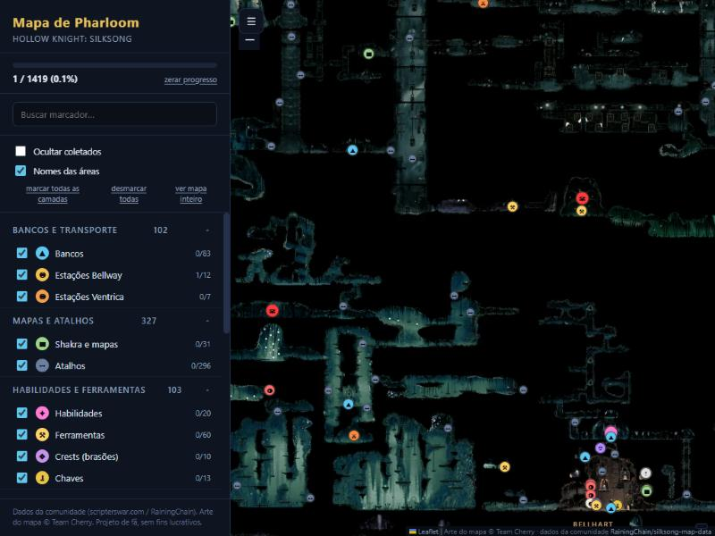

# Mapa de Pharloom

Mapa interativo de **Hollow Knight: Silksong**, em português, para rodar offline
no seu PC. Pan, zoom, filtros por categoria, busca e marcação de progresso —
no estilo do Map Genie, mas local, sem anúncios e sem login.



## O que tem dentro

**1419 marcadores** em 35 categorias, cobrindo 100% do jogo:

| Grupo | Categorias |
|---|---|
| Bancos e transporte | bancos, estações Bellway, estações Ventrica |
| Mapas e atalhos | Shakra e mapas, atalhos |
| Habilidades e ferramentas | habilidades, ferramentas, crests, chaves |
| Melhorias | fragmentos de máscara e carretel, medalhões de memória, corações de seda, kits, bolsas, Pale Oils, craftmetals |
| Combates | chefes, arenas |
| Colecionáveis | pulgas perdidas, itens de troca, lembranças, devoradores de seda |
| NPCs e desejos | NPCs, vendedores, desejos, itens de desejo |
| Moedas e recursos | cordões e depósitos de rosários, pacotes e depósitos de cacos |
| Flags e diversos | flags permanentes, informações |

Mais 51 rótulos de área sobre o mapa.

## Como rodar

Precisa de Python 3.9+ e de uma conexão para a primeira carga.

```bash
python scripts/baixar_tiles.py
```

```bash
python -m http.server 8777 --directory web
```

Depois abra <http://localhost:8777>.

> Não dá para abrir o `web/index.html` com duplo clique: o navegador bloqueia
> `fetch` em `file://`. Precisa do servidor local — é o comando acima.

### Níveis de zoom

Os tiles vêm em níveis de 8 (visão geral, 1 tile) a 1 (detalhe máximo,
81920×60416 px). O padrão baixa até o nível 3:

```bash
python scripts/baixar_tiles.py --ate 2
```

| `--ate` | Resolução | Tiles | Disco |
|---|---|---|---|
| 4 | 10240×8192 | ~90 | 7 MB |
| 3 *(padrão)* | 20480×15360 | ~310 | 24 MB |
| 2 | 40960×30720 | ~1070 | 85 MB |
| 1 | 81920×60416 | ~3600 | ~300 MB |

O app detecta sozinho o que você baixou e ajusta o zoom máximo.

## Como usar

- **Filtrar** — marque e desmarque categorias no painel da esquerda.
- **Buscar** — digite parte do nome; clicar no resultado voa até o marcador.
- **Marcar progresso** — clique num pino e em *marcar como coletado*. Fica
  salvo no `localStorage` do navegador (por dispositivo, não sincroniza).
- **Ocultar coletados** — some com o que você já pegou.
- **Coordenadas** — aparecem no canto inferior direito, no mesmo sistema do
  dataset de origem.

## Estrutura

```
dados/
  cache/silksong_live.json   dataset bruto baixado (não versionado)
  nao_traduzidos.txt         nomes mantidos em inglês (nomes próprios)
scripts/
  baixar_tiles.py            baixa os tiles do mapa
  glossario.py               dicionário e regras de tradução pt-BR
  preparar_dados.py          gera web/dados/mapa.json
web/
  index.html  css/  js/      o app
  dados/mapa.json            dataset traduzido (versionado)
  tiles/                     tiles do mapa (não versionados)
  vendor/                    Leaflet 1.9.4
```

Para regenerar os dados depois de mexer no glossário:

```bash
python scripts/preparar_dados.py --baixar
```

## Sobre a tradução

Termos descritivos vão para o português (*Bench* → *Banco*, *One-Way Shortcut -
Down* → *Atalho de mão única — para baixo*). Nomes próprios do jogo — áreas,
chefes, NPCs, ferramentas, habilidades, crests, chaves — ficam em inglês, que é
como a comunidade brasileira se refere a eles e evita inventar nomes que não
batem com a localização oficial.

Os 22 nomes sem tradução dedicada estão em `dados/nao_traduzidos.txt`. Para
mudar qualquer coisa, edite `scripts/glossario.py` e rode `preparar_dados.py`
de novo.

## Créditos e licença

Projeto de fã, sem fins lucrativos.

- **Arte do mapa e o jogo**: © [Team Cherry](https://www.teamcherry.com.au/).
  Os tiles não são redistribuídos aqui — o script baixa direto da fonte.
- **Dados dos marcadores**: comunidade do
  [Silksong Interactive Map](https://scripterswar.com/silksong/map), mantidos em
  [RainingChain/silksong-map-data](https://github.com/RainingChain/silksong-map-data).
- **Leaflet** 1.9.4, BSD-2-Clause.

O código deste repositório está sob licença MIT (veja `LICENSE`). A licença não
se estende à arte do mapa nem ao dataset de marcadores, que pertencem aos
respectivos donos.
